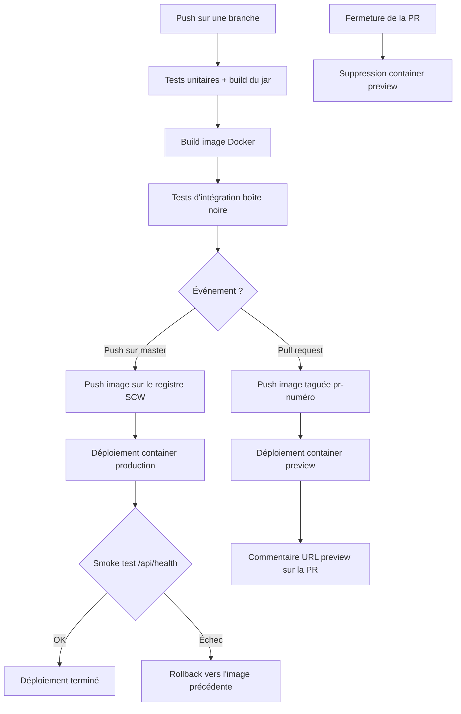

        # demo-deploy

API Spring Boot (Kotlin) de gestion d'un catalogue de livres, servie sous `/api`.

## Prérequis

- JDK 25
- Docker, avec `docker compose` ou `docker-compose` (sur macOS : `colima start`)

### Installer Java 25 sur macOS

Avec [Homebrew](https://brew.sh) :

```bash
brew install openjdk@25
sudo ln -sfn /opt/homebrew/opt/openjdk@25/libexec/openjdk.jdk /Library/Java/JavaVirtualMachines/openjdk-25.jdk
```

Ou avec [SDKMAN!](https://sdkman.io) :

```bash
curl -s "https://get.sdkman.io" | bash
sdk install java 25-tem
```

Vérifier l'installation :

```bash
java -version
```

## Lancer l'application

```bash
./gradlew :book-store:bootRun
```

L'API répond sur `http://localhost:8080/api` :

```bash
curl localhost:8080/api/health
curl localhost:8080/api/books
curl -H 'Content-Type: application/json' -d '{"title":"Dune","bookKind":"sf"}' localhost:8080/api/books
```

Pour la lancer dans Docker, comme en production :

```bash
./gradlew :book-store:bootJar
docker compose up -d --build
docker compose down -v
```

## Tests

Trois couches, de la moins chère à la plus chère.

### 1. Tests unitaires — `book-store`

Domaine et mapping, sans réseau ni Docker.

```bash
./gradlew :book-store:test
```

### 2. Tests d'intégration boîte noire — `book-store-ti`

Le module ne dépend pas de l'application : il l'interroge en HTTP, via son contrat d'API.
Il n'est pas lancé par `./gradlew build`.

Contre l'application dockerisée (build du jar, montée de la stack, tests, démontage) :

```bash
./gradlew ti
```

Contre une application déjà démarrée :

```bash
BASE_URL=http://localhost:8080/api ./gradlew :book-store-ti:integrationTest
```

Variables : `BASE_URL` (défaut `http://localhost:8080/api`), `READINESS_TIMEOUT_SECONDS` (défaut `60`).

### 3. Smoke test post-déploiement

Joué par la CI après chaque déploiement sur `master` : appel de `/api/health` sur le
conteneur déployé, avec retries. Rien à lancer en local.

## Déploiement

Le pipeline (`.github/workflows/ci.yml`) démarre toujours par les mêmes étapes : tests
unitaires, build du jar, build de l'image Docker, puis tests d'intégration boîte noire
sur cette image. L'image ainsi validée est ensuite déployée différemment selon le
contexte :

- **Push sur `master`** → l'image est poussée sur le registre Scaleway puis déployée
  sur le container de production. Un smoke test sur `/api/health` valide le
  déploiement ; en cas d'échec, le container revient automatiquement à l'image
  précédente (rollback).
- **Pull request** → l'image est poussée sous un tag dédié (`pr-<numéro>`) et déployée
  sur un container de preview propre à la PR, dont l'URL est commentée automatiquement
  sur la PR.
- **Fermeture de la pull request** → le container de preview associé est supprimé
  (`pr-preview-cleanup.yml`).


