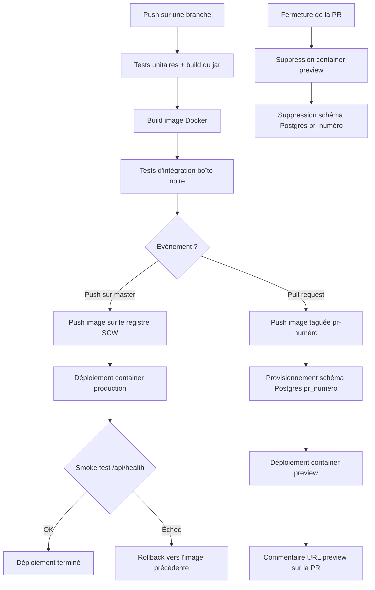

# book-store

API Spring Boot (Kotlin) d'un catalogue de livres, servie sous `/api`.
Les fronts n'appellent que les vues BFF (`/pages/...`).

## Prérequis

- JDK 25 (`brew install openjdk@25` ou `sdk install java 25-tem`)
- Docker avec `docker compose` (sur macOS : `colima start`)

## Lancer

```bash
./gradlew :book-store:bootRun          # HSQLDB locale, dans book-store/data/
docker compose up -d --build           # comme en prod : Postgres 17 + profil postgres
docker compose down -v                 # arrête et remet la base à zéro
```

```bash
curl localhost:8080/api/pages/catalog
curl -H 'Content-Type: application/json' -d '{"title":"Dune","kind":"sf","format":"hardcover","bookPriceInCents":1200}' localhost:8080/api/pages/catalog/books
```

## Lint et tests

```bash
./gradlew ktlintCheck            # ktlintFormat pour corriger
./gradlew :book-store:test       # tests unitaires, sans Docker
./gradlew ti                     # TI boîte noire sur Postgres 17 (compose up, tests, compose down)
BASE_URL=http://localhost:8080/api ./gradlew :book-store-ti:integrationTest   # TI contre une app déjà lancée
```

## Architecture

```
front ──▶ bff/            un contrôleur par page, orchestre les domaines
           ├──▶ book/     livres
           └──▶ format/   formats et leur supplément
```

- Chaque domaine : `domain/` (modèle, règles, ports) et `adapter/outbound/` (JPA).
- Un domaine n'importe jamais l'autre : ce qui croise les deux passe par le BFF, par exemple le prix total (livre + supplément du format).
- Les formats sont en base (`product_formats`) : un format = une ligne, sans recompiler.
- Erreurs : exceptions métier nommées, traduites en code `BBE-*` par `web/error/ErrorHandlingAdvice`. 400 = requête mal formée, 422 = règle métier.
- Chaque requête porte un id (`X-Request-Id`), repris dans les erreurs et les logs.

## Persistance

- Schéma créé par Hibernate (`ddl-auto: update`) : ajoute tables et colonnes, ne supprime ni ne renomme jamais.
- `data.sql` est joué à chaque démarrage et n'insère que ce qui manque (formats, livres de départ si le catalogue est vide).
- HSQLDB en local et dans les tests unitaires, Postgres 17 dans compose et les TI, Postgres managé en prod **et en preview de PR**. Pas de H2 : licence hors MIT/Apache/BSD.

### Brancher la production sur Postgres

Le job `deploy` de la CI pose tout l'environnement du container de production à chaque déploiement :

| Variable du container | Type Scaleway | Source |
|---|---|---|
| `JAVA_TOOL_OPTIONS` | variable | `-XX:MaxRAMPercentage=75`, en dur dans `ci.yml` |
| `SPRING_PROFILES_ACTIVE` | variable | `postgres`, en dur dans `ci.yml` |
| `DATABASE_URL` | secrète | secret GitHub `DATABASE_URL` : `jdbc:postgresql://<host>:<port>/<base>?sslmode=require` |
| `DATABASE_USERNAME` | secrète | secret GitHub `DATABASE_USERNAME` |
| `DATABASE_PASSWORD` | secrète | secret GitHub `DATABASE_PASSWORD` |

- Les trois secrets GitHub se déclarent sur l'environnement `production` (ou sur le repo).
- La CI est la seule source de l'environnement de production : `scw container container update` remplace les variables en entier, donc une variable ajoutée à la main dans la console Scaleway disparaît au déploiement suivant. Une nouvelle variable s'ajoute dans `ci.yml`.
- Un secret GitHub absent arrête le job avant toute modification du container (étape `Check database secrets`).

Le profil n'a aucune valeur par défaut : une variable absente fait échouer le démarrage, puis le smoke test du déploiement, au lieu de retomber sur HSQLDB. Une `DATABASE_URL` absente apparaît dans les logs comme `'url' must start with "jdbc"`.

`data.sql` est compatible avec les deux moteurs (`MERGE` existe depuis Postgres 15). Les TI le jouent sur Postgres 17 à chaque build. Une base de production en version 14 ou moins ne démarrerait pas.

Limite assumée : le schéma de production reste géré par `ddl-auto: update`. Sur une base qui dure, un outil de migration (Flyway) devient nécessaire dès qu'une colonne doit être renommée ou supprimée.

### Base des previews de PR

Les previews partagent l'instance Postgres de la prod, mais pointent sur une **base dédiée**
(`book_store_preview`, distincte de la base de prod) avec un **schéma Postgres par PR**
(`pr_<numéro>`) : une preview ne lit et n'écrit jamais dans les données d'une autre PR, et
jamais dans celles de la prod.

| Variable du container | Type Scaleway | Source |
|---|---|---|
| `SPRING_PROFILES_ACTIVE` | variable | `postgres`, en dur dans `ci.yml` |
| `DATABASE_URL` | secrète | construite dans `ci.yml` à partir de `PREVIEW_DATABASE_HOST/PORT/NAME` + `?currentSchema=pr_<numéro>` |
| `DATABASE_USERNAME` | secrète | secret GitHub `PREVIEW_DATABASE_USERNAME` |
| `DATABASE_PASSWORD` | secrète | secret GitHub `PREVIEW_DATABASE_PASSWORD` |

- Le job `deploy-pr-preview` crée le schéma (`CREATE SCHEMA IF NOT EXISTS`) avant de déployer
  le container, à chaque push sur la PR : les données d'une preview survivent donc à ses
  redéploiements successifs, contrairement au comportement précédent (HSQLDB locale au
  container, perdue à chaque redéploiement).
- Le job `pr-preview-cleanup.yml` supprime le schéma (`DROP SCHEMA ... CASCADE`) à la
  fermeture de la PR, en plus du container.
- Le rôle `PREVIEW_DATABASE_USERNAME` n'a de droits que sur la base `book_store_preview` :
  il ne peut pas se connecter à la base de production, même en cas de faille côté CI.
- Prérequis d'infra (hors CI, à faire une fois par un admin DB) : créer la base
  `book_store_preview` et le rôle associé sur l'instance Postgres existante, puis déclarer
  les 5 secrets GitHub `PREVIEW_DATABASE_HOST`, `PREVIEW_DATABASE_PORT`,
  `PREVIEW_DATABASE_NAME`, `PREVIEW_DATABASE_USERNAME`, `PREVIEW_DATABASE_PASSWORD`.

## Déploiement

Le pipeline (`.github/workflows/ci.yml`) démarre toujours par les mêmes étapes : tests
unitaires, build du jar, build de l'image Docker, puis tests d'intégration boîte noire
sur cette image. L'image ainsi validée est ensuite déployée différemment selon le
contexte :

- **Push sur `master`** → l'image est poussée sur le registre Scaleway puis déployée
  sur le container de production. Un smoke test sur `/api/health` valide le
  déploiement ; en cas d'échec, le container revient automatiquement à l'image
  précédente (rollback).
- **Pull request** → l'image est poussée sous un tag dédié (`pr-<numéro>`), un schéma
  Postgres `pr_<numéro>` est provisionné sur la base preview, puis le container est
  déployé avec ce schéma, dont l'URL est commentée automatiquement sur la PR.
- **Fermeture de la pull request** → le container de preview et son schéma Postgres sont
  supprimés (`pr-preview-cleanup.yml`).


